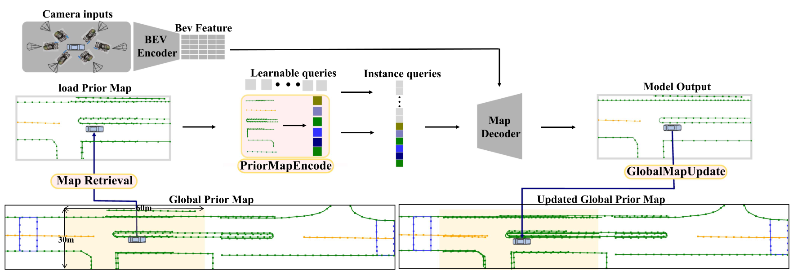

# InstGPMap: Real-Time Instance-Level Global Prior Mapping via Historical Predictions Fusion

Official implementation of **InstGPMap** (IEEE Robotics and Automation Letters, Vol. 11, No. 1, 2026).

Baoquan Chen\*, Zhongxing Ma\*, Pengcheng Zhu, Yaoming Zhuang†, Weixin Lu, Haoyang Zhao

\* Equal contribution &nbsp;&nbsp; † Corresponding author

[[Paper (IEEE Xplore)](https://doi.org/10.1109/LRA.2025.3634878)]



## Abstract

Online HD map construction methods infer local maps directly from sensor observations, but suffer from a limited perception range, especially under occlusion by large vehicles or poor visibility in rain. Existing global-prior approaches built from historical observations often need large storage or complex post-processing, which limits their real-time usability. **InstGPMap** is an online framework that explicitly represents and maintains global prior map (**GPMap**) elements **at the instance level**. It uses historical *predictions* directly, rather than implicit intermediate representations such as BEV features. It also assigns consistent instance IDs to map elements across frames, which enables direct instance-level association and updating.

InstGPMap has two core modules:

- **Global Map Update Module**: associates and manages GPMap elements across frames through four operations: *Retrieval*, *Addition*, *Modification* and *Deletion*.
- **Prior Map Encode Module**: encodes the retrieved instance-level GPMap elements into track queries. These are concatenated with learnable queries and fed to the map decoder.

InstGPMap achieves state-of-the-art performance on nuScenes, with high accuracy and very low storage cost.

## Method

**GPMap.** The GPMap is a set of instance subsets `M_id`, one per global instance ID. Each element stores its geometry (20 BEV points), confidence score, category label and the ego-vehicle global position.

**Global Map Update Module**

| Operation | Description |
|:--|:--|
| Retrieval | Range filtering of a 30 m × 60 m region around the ego pose, then Distance-Based Selection of representative elements per instance at predefined distances (default `[1, 5, 10, 15, 20]` m) |
| Addition | Predictions from learnable queries get a new instance ID and form a new subset; predictions from track queries inherit the existing ID |
| Modification | Elements are stored on an ego-position grid; if a cell is occupied, the element with the higher confidence is kept |
| Deletion | An instance is removed when the confidence of its tracked prediction falls below τ = 0.6 |

**Prior Map Encode Module**

- *Query Encoding*: content query = `Linear(one_hot(label)) + Linear(conf)`, position query = `PE(coords)`, track query = `concat(content, position)`.
- *Query Fusion*: cross-attention with the nearest prior element as query and the remaining selected elements as keys/values (padded to 5), producing one track query per instance.

**Training.** Instance-level matching: tracked GT instances inherit their assignment from the GPMap, and new GT instances are matched by bipartite matching (focal loss + permutation-invariant line loss). Consistent GT instance IDs come from a globally consistent instance graph built over all frames.

## Main Results (nuScenes)

| Setting | mAP |
|:--|:--:|
| InstGPMap, 24 epochs | 67.5 |
| InstGPMap, 48 epochs | 71.7 |

- Single-trip: **+3.2 mAP** over the baseline under a unified protocol (vs. +1.0 NMP, +3.4 PreSight, +2.5 GlobalMapNet), using only **3.9 MB/km** of prior storage.
- Multi-trip ("long-term prior accumulation"): **+3.7 mAP** over the baseline.
- Argoverse2: **+3.6 mAP** over the baseline.
- Speed: 8.7 FPS; **10.2 FPS** when the Global Map Update Module runs asynchronously on a CPU thread.

See the paper for the full tables and ablations.

## Code Structure

The code is built on [MapTracker](https://github.com/woodfrog/maptracker). Class names such as `MapTracker` / `MapDetectorHead` are kept for checkpoint compatibility.

| Paper component | Code |
|:--|:--|
| GPMap storage and management | `nmp/map_global_memory.py` → `MapGlobalMemory` (`bank_list`: `"{label}_{instance_id}" → {ego_xy: [polyline, score]}`) |
| Retrieval (range filtering + distance-based selection) | `MapGlobalMemory.take_map_prior`, `MapGlobalMemory.select_memory_entries` |
| Addition / Modification / Deletion | `MapGlobalMemory.replace_map_prior` |
| Query Encoding | `plugin/models/mapers/MapTracker.py` → `MapTracker.use_prev_pred_encode_function` |
| Track queries from GPMap & Query Fusion (memory cross-attention) | `MapTracker.temporal_propagate` (`use_memory_bank_new`) |
| Instance-level matching | `MapTracker.prepare_track_queries_and_targets_nmp` |
| Online inference loop (retrieve → predict → update) | `MapTracker.forward_test` |
| Thresholds and update switches | `global_parameter.py` (`thr_track`, `map_add` / `map_rm` / `map_change`, `single_traversal`) |

`PRIOR_MODE` in the configs:

| Mode | Meaning |
|:--|:--|
| `v1` | No prior (baseline) |
| `v2` | Previous-frame prior only |
| `v3` | GPMap prior: the nearest element of each retrieved instance is encoded as a track query |
| `v4` | `v3` + Query Fusion over the distance-selected elements (memory cross-attention) |
| `v5` | No prior during training, `v3` at inference |

Configs with `PRIOR_MODE='v4'` (Query Fusion enabled): `instgpmap_nusc_oldsplit_v3.py`, `instgpmap_nusc_oldsplit_v3_distRange4.py`, `instgpmap_nusc_oldsplit_v3_trainpkl.py`. The distance-selection ranges are set by `mem_select_dist_ranges` in each config.

## Installation

See [docs/installation.md](docs/installation.md).

## Data Preparation

See [docs/data_preparation.md](docs/data_preparation.md).

## Getting Started

InstGPMap configs live in `plugin/configs/instgpmap/nuscenes_oldsplit/instgpmap_nusc_oldsplit*.py`. Training starts from the stage-2 (warmup) checkpoint set by `load_from` in the config (e.g. `pretrained_ckpts/maptracker_nusc_oldsplit_5frame_span10_stage2_warmup/latest.pth`), which can be produced with the stage-1/2 configs in the same folder:

```bash
bash tools/dist_train.sh plugin/configs/instgpmap/nuscenes_oldsplit/maptracker_nusc_oldsplit_5frame_span10_stage1_bev_pretrain.py 8
bash tools/dist_train.sh plugin/configs/instgpmap/nuscenes_oldsplit/maptracker_nusc_oldsplit_5frame_span10_stage2_warmup.py 8
```

### Training

```bash
CUDA_VISIBLE_DEVICES=0,1,2,3,4,5,6,7 bash tools/dist_train.sh \
  plugin/configs/instgpmap/nuscenes_oldsplit/instgpmap_nusc_oldsplit_v3_shuffle.py 8
```

### Evaluation (mAP)

```bash
CUDA_VISIBLE_DEVICES=0,1,2,3,4,5,6,7 bash tools/dist_test.sh \
  plugin/configs/instgpmap/nuscenes_oldsplit/instgpmap_nusc_oldsplit_v3_shuffle.py \
  work_dirs/instgpmap_nusc_oldsplit_v3_shuffle/latest.pth 8 --eval --eval-options save_semantic=True
```

### Evaluation (C-mAP)

```bash
python tools/tracking/prepare_pred_tracks.py ${CONFIG} --result_path ${SUBMISSION_FILE} --cons_frames ${COMEBACK_FRAMES}
python tools/tracking/calculate_cmap.py ${CONFIG} --result_path ${PRED_MATCHING_INFO}
```

### Visualization

```bash
python tools/visualization/vis_global.py ${CONFIG} \
  --data_path ${PATH_TO_PKL} \
  --out_dir ${OUT_DIR} \
  --option vis-pred \
  --per_frame_result 1
```

Use `--option vis-gt` with `datasets/nuscenes/nuscenes_map_infos_val_gt_tracks.pkl` to visualize the ground truth; set `--per_frame_result 0` to only produce the merged global map.

## Citation

```bibtex
@article{chen2026instgpmap,
  title   = {InstGPMap: Real-Time Instance-Level Global Prior Mapping via Historical Predictions Fusion},
  author  = {Chen, Baoquan and Ma, Zhongxing and Zhu, Pengcheng and Zhuang, Yaoming and Lu, Weixin and Zhao, Haoyang},
  journal = {IEEE Robotics and Automation Letters},
  volume  = {11},
  number  = {1},
  pages   = {722--729},
  year    = {2026},
  doi     = {10.1109/LRA.2025.3634878}
}
```

## Acknowledgement

This codebase is built upon [MapTracker](https://github.com/woodfrog/maptracker), [StreamMapNet](https://github.com/yuantianyuan01/StreamMapNet), [BEVFormer](https://github.com/fundamentalvision/BEVFormer) and [MapTR](https://github.com/hustvl/MapTR). We thank the authors for releasing their code.

## License

This project is a derivative of MapTracker and is released under the GPLv3 (see [LICENSE](LICENSE) and [LICENSE_GPL](LICENSE_GPL)). Commercial use is not permitted.
